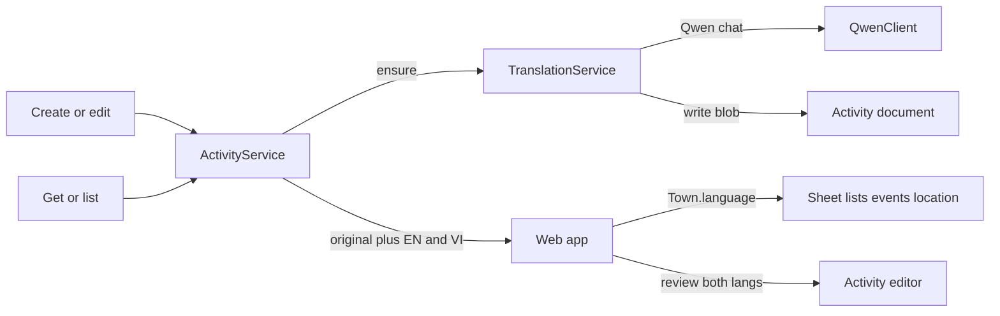

# Requirements

### Overview & Goals

Add a reusable AI translation pipeline so activity names and descriptions are available in English and Vietnamese. Authors still type one name and description; after save they can review and edit both languages. Viewers see the activity in `Town.language`. Chat attachments stay as the original snapshot.

### Scope

#### In Scope
- Generic `TranslationService` that any entity can reuse via a persist callback and a field map (`name`, `description`, …).
- Embed a translations blob on the activity document (not a separate collection).
- Enqueue a translation job on activity create and on source-text edit.
- On get/list, enqueue if the blob is missing, stale, or failed (with cooldown).
- API returns original `name`/`description` plus EN and VI; the web app picks the locale.
- Localized display on the activity sheet, my-activities, location sheet, discover/events lists.
- Activity editor: keep the single source fields, then show EN/VI review fields after save (poll while pending).

#### Out of Scope
- Chat activity cards (leave the stored snapshot).
- Translating location names, community names, posts, products, or other entities (the service is built so those can hook in later).
- Server-side locale selection / `Accept-Language`.
- A separate translations collection or admin translation UI.

### User Stories

- As an activity author, I type one name and description and after save I can see and edit the English and Vietnamese versions.
- As a viewer, I see activity titles and descriptions in my UI language, falling back to the original if a translation is not ready.
- As an author, if translation failed or never ran, opening or listing the activity retries it without blocking the page.

### Functional Requirements

- Original `name` and `description` remain the canonical source. Translations are an overlay keyed by locale and field.
- Target locales are `en` and `vi`. One Qwen chat call fills both, including a lightly cleaned copy when the source is already in that language.
- Create/update of source text sets status `pending` and runs the job in a background executor (same pattern as avatars / quick replies).
- Get, list, mine, join, and leave call `ensure` so missing/stale/failed blobs retry. Failed jobs wait 5 minutes before retry. In-flight jobs are deduped.
- If Qwen is not configured, skip the job and show original text. Create/update still succeed.
- Author-saved EN/VI overrides keep status `ready` and the same source hash so a late AI job does not overwrite them. Changing the source hash re-runs AI and replaces translations.
- Chat `activityName` / `activityDescription` continue to snapshot `ActivityRecord.name` / `.description`.
- Display fallback: translated field if non-blank for `Town.language`, else original.

### Non-Functional Requirements

- Translation must not block HTTP responses.
- List endpoints must not stampede Qwen: in-memory inflight set, small daemon pool, failed cooldown.
- AI output is clipped to `Limits.ACTIVITY_NAME_MAX` / `ACTIVITY_DESCRIPTION_MAX`.

# Technical Design

### Current Implementation

- `ActivityRecord` stores a single `name` and `description` (`server/src/main/kotlin/quest/saigon/town/Models.kt`). `ActivityService` writes them on create/update; `activityPayload` in `TownRoutes.kt` returns those fields unchanged.
- Persistence is a full-document replace in `ArangoTownRepository.activityDocument` / `activityFrom`. Nested maps already exist for `schedule`.
- Background AI uses daemon executors: `AvatarService`, `MusicService`, `QuickReplyService` in `TownServices.kt`. Text AI is `QwenClient.chat`. JSON scraping follows `CommunityPrompts.parse`.
- UI language is `Town.language` (`Language.EN` / `Language.VI`) from `sq_lang` + browser. `http()` does not send `Accept-Language`.
- Display sites all read `activity.name` / `activity.description`: `ActivitiesUi.kt` (sheet, lists, editor), `EventsUi.kt` (`activityName`), `LocationUi.kt` (`activityName`). Chat cards in `MessagesUi.kt` use the snapshot and stay as-is.
- Tests: `ActivityBehaviorTest` builds `TownServices` with `InMemoryTownRepository` and a sync executor for avatars/music.

### Key Decisions

- **Embed on the entity.** `TranslationBlob` lives on `ActivityRecord`. `TranslationService` stays entity-agnostic through `fields: Map<String, String>` and `persist: (TranslationBlob) -> Unit`.
- **Client picks locale.** Payloads include original plus `translations.en` / `translations.vi`. The web app uses `Town.language`.
- **Original text stays canonical.** `name` / `description` never become localized. Chat snapshots keep working.
- **Review after save.** Editor keeps one source pair, then shows EN/VI fields and polls GET until ready/failed.
- **Retry with guards.** `ensure` on read/write; inflight key `activity:{id}:{sourceHash}`; 5-minute failed cooldown; persist only if the live source hash still matches and live status is not already `ready` for that hash (protects author overrides from a late AI write).

### Proposed Changes

Add a generic translation job and hang it off activities.



`TranslationService.ensure` no-ops when Qwen is off, when the blob is `ready` for the current hash, when a matching job is inflight, or when `failed` is still inside the cooldown. Otherwise it persists `pending` (if not already) and runs `Translator.translate` on a 2-thread daemon pool.

`ActivityService` passes `mapOf("name" to name, "description" to description)` and persists with `repo.updateActivity(live.copy(translations = blob))` only after re-reading the activity.

`PATCH /api/activities/{id}`: if source hash changed, enqueue and ignore submitted translations. If source hash is unchanged and the body includes `translations`, save those as `ready` overrides.

### Data Models / Contracts

```kotlin
data class TranslationBlob(
    val sourceHash: String,
    val status: String, // pending | ready | failed
    val error: String? = null,
    val updatedAt: Long = 0L,
    val locales: Map<String, Map<String, String>> = emptyMap(),
)

fun interface Translator {
    fun translate(fields: Map<String, String>, locales: List<String>): Map<String, Map<String, String>>
}
```

`ActivityRecord` gains `val translations: TranslationBlob? = null`. Source hash is SHA-256 of sorted `field\u0001value` pairs.

Activity JSON (`activityPayload`) adds:

```json
"translations": {
  "status": "ready",
  "en": { "name": "Coffee walk", "description": "Hang out at The Workshop" },
  "vi": { "name": "Đi cà phê", "description": "Tụ tập ở The Workshop" }
}
```

Omit `translations` when null. Do not expose `sourceHash`.

Qwen prompt (JSON only): `{"en":{"name":"…","description":"…"},"vi":{"name":"…","description":"…"}}`. Parse like `CommunityPrompts`; on parse/HTTP failure mark `failed` (no invented fallback). Clip to activity limits.

Client helper in `quest.saigon.web`:

```kotlin
internal fun localizedActivityText(activity: dynamic, field: String): String
```

Uses `Town.language` → `en`/`vi`, then `translations[locale][field]`, else original.

### File Structure

**Add**
- `server/src/main/kotlin/quest/saigon/ai/TranslationPrompts.kt` — system/user prompt and JSON parse
- `server/src/main/kotlin/quest/saigon/town/TranslationService.kt` — hash, `needsWork`, `ensure`, overrides, inflight, executor
- `server/src/test/kotlin/quest/saigon/TranslationBehaviorTest.kt` — fake `Translator`, sync executor

**Modify**
- `Models.kt` — `TranslationBlob`, `ActivityRecord.translations`
- `ActivityService.kt` — ensure on create/update/get/list/mine/join/leave; persist guard; accept overrides on update
- `TownServices.kt` — construct `TranslationService` from `QwenClient`; inject into `ActivityService`
- `ArangoTownRepository.kt` — read/write `translations` on the activity document
- `TownRoutes.kt` — `activityPayload` translations object; parse optional PATCH `translations`
- `ActivitiesUi.kt` — helper, sheet/list copy, editor review + poll
- `EventsUi.kt` / `LocationUi.kt` — localized titles
- `Copy.kt` — translating / failed strings (reuse `languageEn` / `languageVi` as section headers)

`TownRepository` needs no new methods. `InMemoryTownRepository` stores the record as-is.

### Risks

- **List stampede:** inflight set + 2-thread pool + 5-minute failed cooldown.
- **Stale/late AI overwrite:** persist only if live source hash matches and live blob is not already `ready` for that hash.
- **Editor interval leaks:** clear poll timer on close.
- **Over-long AI text:** clip to existing activity limits.
- **Qwen down:** status `failed`, UI shows original, retry on later load after cooldown.

# Testing

### Validation Approach

Extend HTTP tests the same way as `ActivityBehaviorTest`: `testApplication` + `InMemoryTownRepository` + injected `TranslationService` with a fake `Translator` and `executor = { it.run() }` so jobs run inline.

Existing `ActivityBehaviorTest` stays green: default `TranslationService(configured = false)` does not enqueue, and `name` remains the original source.

### Key Scenarios

- Create with a fake translator returns `translations.status = ready` and both `en`/`vi` name and description; original `name` is unchanged.
- GET of an activity with no blob enqueues and fills translations.
- PATCH that changes `name` recomputes the hash and re-translates.
- PATCH with the same source plus `translations` saves overrides and does not call the translator.
- List/mine payloads include the translations object so the client can localize without extra requests.
- Chat attachment after create still snapshots the original `activityName`.

### Edge Cases

- `configured = false`: create succeeds, `translations` is omitted/null.
- Translator throws: status `failed`; an immediate GET does not retry; advancing the clock past 5 minutes retries.
- Late AI result after author overrides: persist guard keeps the overrides.
- Source changed while a job runs: persist guard drops the stale blob.
- Invalid translation field length is clipped to `Limits.ACTIVITY_NAME_MAX` / `ACTIVITY_DESCRIPTION_MAX`.

# Delivery Steps

### ✓ Step 1: Add reusable TranslationService and persist blob on activities
Activities can store a generic translations blob, and TranslationService can hash source fields, enqueue Qwen jobs, and persist pending/ready/failed without knowing about activities.

- Add `TranslationBlob` and `ActivityRecord.translations` in `Models.kt`.
- Add `TranslationPrompts.kt` (system/user prompt + JSON parse, same style as `CommunityPrompts`).
- Add `TranslationService` with `Translator`, source hash, inflight set, 5-minute failed cooldown, `ensure`, and override helper.
- Wire `QwenClient.chat` as the production translator in `TownServices.open`.
- Read/write the blob in `ArangoTownRepository.activityDocument` / `activityFrom` (nested map, same pattern as `schedule`).

### ✓ Step 2: Trigger translation from ActivityService and expose it on the API
Create, edit, and load paths enqueue translation when needed, and every activity payload includes original text plus EN/VI for the client to pick.

- Inject `TranslationService` into `ActivityService`; call `ensure` on create, source-changing update, get, list, mine, join, and leave.
- Persist through a re-read guard so stale jobs and late AI results cannot overwrite a newer source hash or author `ready` overrides.
- Parse optional PATCH `translations` in `TownRoutes.kt`; save as overrides when the source hash is unchanged.
- Extend `activityPayload` with `translations.status` / `en` / `vi`; omit when null.
- Keep chat snapshots on `ActivityRecord.name` / `.description`.
- Add `TranslationBehaviorTest` with a fake translator and sync executor; leave `ActivityBehaviorTest` on the unconfigured default.

### ✓ Step 3: Show activities in the viewer UI language
Activity sheet, lists, location sheet, and events/discover use Town.language, falling back to the original name and description.

- Add `localizedActivityText(activity, field)` in the web package using `Town.language` → `en`/`vi`.
- Use it for name and description in `ActivitiesUi.kt` (sheet, discover list, my-activities, location activity rows).
- Point `EventsUi.kt` and `LocationUi.kt` `activityName` helpers at the localized name.
- Leave `MessagesUi.kt` chat cards on the snapshot fields.

### ✓ Step 4: Let authors review and edit English and Vietnamese after save
The activity editor keeps one source name/description, then shows both generated languages and can save overrides without re-running AI.

- After create/update, keep the editor open, refresh from the response, and poll `GET /api/activities/{id}` while status is `pending` (stop on ready/failed, timeout, or close).
- Add EN/VI name and description fields, labeled with existing `languageEn` / `languageVi`.
- Include those values on save so unchanged source + edited translations hit the override path.
- Add Copy keys for translating/failed states; disable or hint the locale fields while pending.
- When opening an existing activity, show ready translations immediately and poll if missing/pending/failed (GET retriggers `ensure`).