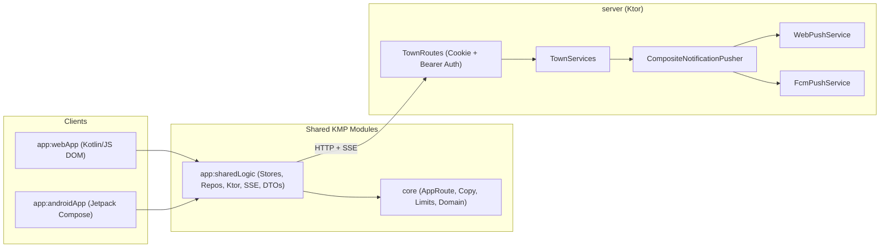

# Requirements

### Overview & Goals
Build a native Android application (`:app:androidApp`) with full feature parity to `:app:webApp` (Saigon.Town), sharing all non-UI networking, serialization, business logic, real-time streaming, and reactive feature state in `:app:sharedLogic` and `:core`. The existing Kotlin/JS DOM `:app:webApp` remains live and intact while incrementally adopting `:app:sharedLogic` stores, and `:server` is extended for mobile token authentication and Firebase Cloud Messaging (FCM) push delivery.

### Scope
#### In Scope
- **Shared KMP Layer (`:core` & `:app:sharedLogic`)**: Expand `:app:sharedLogic` (Android + JS + JVM targets) to own all typed API DTOs, Ktor HTTP/SSE clients, repositories, validation, session persistence, and `StateFlow` feature stores.
- **Native Android App (`:app:androidApp`)**: Jetpack Compose UI covering all 22 `AppRoute` destinations and modal workflows (Feed, Auth, Composer, AI Avatar/Music studios, Discover + Google Maps, Locations, Events, Activities, Polls, Questions, Check-ins, Shop & Orders, Messages & Open Chats, Profile & sub-pages, Feature Suggestions, Stats, Admin).
- **Web Integration (`:app:webApp`)**: Preserve the existing Kotlin/JS DOM and CSS UI while migrating networking, session state, and core feature stores to `:app:sharedLogic`.
- **Server Extensions (`:server`)**: Dual `Authorization: Bearer <token>` + `sq_session` cookie authentication, and `FcmPushService` + `/api/push/fcm` composed with `WebPushService`.

#### Out of Scope
- Rewriting `:app:webApp` DOM components into Compose Multiplatform.
- iOS application target (though `:app:sharedLogic` will remain pure KMP and iOS-compatible).
- Full offline-first local database (Room/SQLDelight) caching beyond persisted session credentials, language preferences, and in-memory store caches.

### User Stories
- **As a visitor or member on Android**, I want to browse the full-screen vertical feed with photos, music previews, check-ins, polls, questions, CTAs, and comments so that I get the same immersive Saigon.Town experience as on the web.
- **As a signed-in user**, I want to create posts with cropped photos, AI avatars, AI music, locations, communities, events, polls, questions, CTAs, and open chats directly from my phone.
- **As a community explorer**, I want to browse events, activities, people, communities, and places on an interactive Google Map and open shared `/p/...`, `/c/...`, `/u/...`, `/l/...`, `/product/...`, `/activity/...`, and `/messages/...` links directly in the Android app.
- **As a buyer, seller, or chat participant**, I want to browse Shop listings, place orders, and exchange real-time messages and reactions in 1:1, group, and open chats.
- **As a mobile user**, I want to receive background FCM push notifications for comments, events, orders, and chat messages that open directly to the relevant screen.
- **As an admin**, I want access to `/stats` and `/admin` moderation tools from Android.

### Functional Requirements
1. **Authentication & Session**: Phone/password registration and login (`PhoneNumbers.canonicalize`, password length limits in `Limits`), persistent session storage across app restarts, and logged-out auth gating on protected routes (`/new`, `/profile/*`, `/messages*`, `/admin`).
2. **Feed & Post Interactions**: Cursor-paginated vertical feed, multi-photo carousel, audio preview playback, quick replies, threaded comments, event RSVP, poll voting, question answering, check-in timers, CTA actions (URL / Zalo / in-app chat), and share/copy links.
3. **Discover & Maps**: Google Maps integration with custom place/event/activity pins, place search/autocomplete, custom user locations, location detail sheets (directions intent, community description, photo gallery, activities, posts), and Discover tabs.
4. **Media & AI Creation**: Android Photo Picker with client-side crop/resize (`Limits.PHOTO_MAX_EDGE`, `Limits.AVATAR_MAX_EDGE`, `Limits.JPEG_QUALITY`), AI avatar generation & status polling, and AI music generation & preview playback.
5. **Shop, Activities & Communities**: Product CRUD, product orders (Zalo or direct message), activity scheduling and interest lists, community search/creation/membership/feeds, and profile management screens.
6. **Real-Time Messaging & Push**: Live SSE updates while foregrounded (`/api/notifications/stream`, `/api/messages/stream`, `/api/chats/{id}/stream`), unread badge counters, and FCM background push notifications with deep-link routing via `NotificationCopy.path()`.
7. **Localization**: English/Vietnamese switching via `Copy.text()` and `resolveLanguage()`, synced with user profile preference.

### Non-Functional Requirements
- **Maximum Code Sharing**: Zero duplication of API paths, DTOs, error-key mapping (`Api.kt`), pagination logic, state transitions, or `core` rules (`Limits`, `Copy`, `AppRoute`, `NotificationCopy`, `PhoneNumbers`, `TextLinks`).
- **Visual Consistency**: Compose Material 3 theme mirrors `styles.css` tokens (`#F6F1EA` background, `#FFFDF8` surface, `#E9897C` accent, `#7F7CE9` tertiary, light and dark mode).
- **Resilience**: Automatic SSE reconnection with backoff, graceful handling of network errors (`status == 0` -> `unavailable`) and rate limits (`429` -> `rateLimited`).

# Technical Design

### Current Implementation
- **`:core`** (`core/src/commonMain/kotlin/quest/saigon/`): Pure KMP (`jvm()` + `js()`) containing ~1,600 lines of shared routes (`AppRoute.kt`), localized strings (`Copy.kt`, `NotificationCopy.kt`, `Language.kt`), validation/UI limits (`Limits.kt`), and helpers (`PhoneNumbers.kt`, `LocationLink.kt`, `FeedMotion.kt`, `TextLinks.kt`, `CallToAction.kt`, `CheckIns.kt`).
- **`:app:sharedLogic`** (`app/sharedLogic/`): Currently configures only `js()` and depends on `:core`, holding stub `Greeting.kt` and `Platform.kt` (`jsMain` + unused `jvmMain`).
- **`:app:webApp`** (`app/webApp/src/jsMain/kotlin/quest/saigon/web/`): ~15,400 lines across 29 Kotlin/JS DOM files (`Main.kt`, `Api.kt`, `Town.kt`, `AppUi.kt`, `FeedUi.kt`, `EventsUi.kt`, `MessagesUi.kt`, `ComposerUi.kt`, `Photo.kt`, `MusicUi.kt`, `NotifyUi.kt`, etc.) using `window.fetch`, untyped `JSON.parse`/`dynamic`, `localStorage`, Canvas photo resizing, Web Audio/HTML audio, Google Maps JS, and VAPID Web Push (`sw.js`).
- **`:server`** (`server/src/main/kotlin/quest/saigon/`): Ktor Netty API under `/api` and `/media` (`TownRoutes.kt`, `Application.kt`), ArangoDB persistence (`ArangoTownRepository.kt`), SSE hubs (`NotificationHub.kt`), `WebPushService.kt` implementing `NotificationPusher`, and `sq_session` HTTP-only cookie auth (`ApplicationCall.user()`).

### Key Decisions
1. **Shared Feature Stores + Repositories in `:app:sharedLogic`**:
   - Put typed `@Serializable` DTOs, Ktor `HttpClient` + SSE clients, repositories, and coroutine `StateFlow` feature stores in `:app:sharedLogic/commonMain`.
   - `:app:androidApp` collects these `StateFlow` stores directly in Jetpack Compose (thin Android `ViewModel` wrappers only for SavedState/lifecycle scoping).
   - `:app:webApp` adopts `:app:sharedLogic` stores incrementally (starting with session, auth, feed, and notifications) via JS-friendly state observers while retaining its existing DOM/CSS views.
2. **Dual Bearer Token + Cookie Auth on `:server`**:
   - Keep `sq_session` HTTP-only cookies for `:app:webApp` browsers.
   - Extend `TownRoutes.kt` to return the session token in `/auth/login` and `/auth/register` responses and accept `Authorization: Bearer <token>` in `ApplicationCall.user()` and `/auth/logout`.
   - On Android, store the token securely (`DataStore` + Tink/EncryptedSharedPreferences) and attach it uniformly to Ktor `HttpClient`, SSE connections, Coil `ImageLoader` (for `/api/me/photo` & protected media), and Media3 `ExoPlayer`.
3. **Composite Notification Pusher for FCM + Web Push**:
   - Keep `WebPushService` intact for browsers and add `FcmPushService` + `/api/push/fcm` token registration routes.
   - Compose both in `TownServices.kt` behind `CompositeNotificationPusher : NotificationPusher` so every existing service (`EventService`, `PollService`, `QuestionService`, `ChatService`, `ProductService`, `CommentService`) fans out to both Web and Android without service-layer changes.
4. **Minimal Platform Abstractions**:
   - Use `expect/actual` or injected interfaces only for OS primitives: HTTP engine (`OkHttp` vs `Js`), persistent key-value storage (`TokenStorage`), photo decode/crop/JPEG encoding (`Bitmap` vs `Canvas`), audio playback (`ExoPlayer` vs `HTMLAudioElement`), and external URL/share/directions intents.
   - Keep Google Maps native (`maps-compose` in `:app:androidApp` vs Maps JS in `:app:webApp`), reusing the same `/api/events`, `/api/places/*`, and `/api/config` endpoints (with Android Maps API key configured in Android manifest/build config).

### Architecture Diagram


### File Structure
```text
SaigonQuest2/
├── settings.gradle.kts                       # include(":app:androidApp")
├── gradle/libs.versions.toml                 # AGP, Compose, Ktor client, Serialization, Coil, Media3, Maps, FCM
├── core/
│   └── build.gradle.kts                      # add androidLibrary / androidTarget alongside jvm() and js()
├── app/
│   ├── sharedLogic/
│   │   ├── build.gradle.kts                  # add android target, commonMain Ktor/Coroutines/Serialization
│   │   └── src/
│   │       ├── commonMain/kotlin/quest/saigon/shared/
│   │       │   ├── model/                    # @Serializable DTOs & requests (MeDto, PostCardDto, ChatDto, ...)
│   │       │   ├── network/                  # TownApiClient, SseClient, ApiErrorMapper
│   │       │   ├── platform/                 # expect TokenStorage, AudioPlayer, ImagePreparer
│   │       │   └── store/                    # TownSessionStore, FeedStore, PostDetailStore, DiscoverStore,
│   │       │                                 # ShopStore, ActivityStore, ComposerStore, MessagesStore,
│   │       │                                 # NotificationStore, ProfileStore, StatsStore, AdminStore
│   │       ├── androidMain/kotlin/quest/saigon/shared/platform/
│   │       ├── jsMain/kotlin/quest/saigon/shared/platform/
│   │       └── commonTest/kotlin/quest/saigon/shared/
│   ├── webApp/
│   │   └── src/jsMain/kotlin/quest/saigon/web/ # Main.kt, Api.kt, Town.kt, NotifyUi.kt, FeedUi.kt, MessagesUi.kt wired to sharedLogic
│   └── androidApp/                           # NEW Android application module
│       ├── build.gradle.kts
│       └── src/main/
│           ├── AndroidManifest.xml           # Internet, Notifications, Maps key, App Links
│           └── kotlin/quest/saigon/android/
│               ├── MainActivity.kt
│               ├── SaigonApp.kt              # DI container + NavHost mapped to AppRoute
│               ├── theme/                    # SaigonTheme (colors & typography from styles.css)
│               ├── push/                     # SaigonFirebaseMessagingService
│               ├── media/                    # Bitmap ImagePreparer, Media3 AudioPreviewPlayer, Coil auth setup
│               └── ui/                       # feed/, auth/, composer/, discover/, shop/, activities/,
│                                             # messages/, profile/, stats/, admin/, components/
└── server/
    └── src/main/kotlin/quest/saigon/
        ├── AppConfig.kt                      # FCM credentials/project config
        ├── Application.kt                    # CORS allow Authorization header
        ├── http/TownRoutes.kt                # Bearer auth extraction + token in auth payload + /api/push/fcm
        └── town/
            ├── TownRepository.kt             # FcmTokenRecord CRUD (Arango + InMemory)
            ├── TownServices.kt               # CompositeNotificationPusher wiring
            └── FcmPushService.kt             # FCM HTTP v1 delivery
```

### Data Models / Contracts
```kotlin
// 1. Server Dual Auth (server/src/main/kotlin/quest/saigon/http/TownRoutes.kt)
private fun ApplicationCall.bearerToken(): String? =
    request.headers[HttpHeaders.Authorization]
        ?.takeIf { it.startsWith("Bearer ", ignoreCase = true) }
        ?.substring(7)?.trim()?.takeIf { it.isNotBlank() }

private fun ApplicationCall.sessionToken(): String? =
    bearerToken() ?: requestCookie()

// Auth response payload includes "token" alongside user fields so Android persists it,
// while browsers continue using the sq_session HttpOnly cookie.

// 2. Server FCM Registration & Composite Pusher
@Serializable
data class FcmTokenRequest(val token: String, val language: String = "system")

class CompositeNotificationPusher(
    private val pushers: List<NotificationPusher>,
) : NotificationPusher {
    override fun notify(userId: String, notification: NotificationRecord) {
        pushers.forEach { it.notify(userId, notification) }
    }
}

// 3. Shared Feature Store Contract (app/sharedLogic/commonMain)
interface TokenStorage {
    suspend fun readSessionToken(): String?
    suspend fun writeSessionToken(token: String?)
    suspend fun readLanguage(): String
    suspend fun writeLanguage(preference: String)
}

class FeedStore(
    private val api: TownApiClient,
    private val scope: CoroutineScope,
) {
    val state: StateFlow<FeedUiState>
    fun loadInitial(communityId: String? = null, searchQuery: String? = null)
    fun loadMore()
    fun selectPost(postId: String)
    fun applyPostUpdate(updated: PostCardDto)
}
```

### Proposed Changes
- **`:server` Auth & Push**:
  - Update `ApplicationCall.user()` and `POST /auth/logout` in `TownRoutes.kt` to check `Authorization: Bearer` first, falling back to `sq_session`. Include `"token"` in `/auth/login` and `/auth/register` JSON payloads (while still setting the `sq_session` cookie).
  - Add `POST /api/push/fcm` and `DELETE /api/push/fcm` backed by a new `fcm_tokens` ArangoDB collection (and `InMemoryTownRepository` map for tests).
  - Implement `FcmPushService` using FCM HTTP v1 API (sending `title`, `body`, `url` = `NotificationCopy.path(...)`, `type`, `postId`, `chatId` data payload) and wire `CompositeNotificationPusher(listOf(webPush, fcmPush))` in `TownServices.kt`.
- **`:app:sharedLogic` KMP Architecture**:
  - Enable Android + JS + JVM targets and configure `kotlinx.serialization`, `ktor-client-core` (`ktor-client-okhttp` for Android, `ktor-client-js` for Web), and `kotlinx-coroutines-core`.
  - Port the data models and REST/SSE interactions currently spread across `Town.kt`, `Api.kt`, `NotifyUi.kt`, `FeedUi.kt`, `EventsUi.kt`, `MessagesUi.kt`, `ProductsUi.kt`, `ActivitiesUi.kt`, `ProfileUi.kt`, `StatsUi.kt`, and `AdminUi.kt` into strongly typed DTOs, `TownApiClient`, `SseClient`, and feature `StateFlow` stores.
  - Provide JS-friendly callback/listener hooks in `jsMain` so `:app:webApp` can subscribe to `TownSessionStore`, `NotificationStore`, `MessagesStore`, and `FeedStore` without rewriting all DOM rendering at once.
- **`:app:androidApp` Compose UI & Platform Services**:
  - Build a single-activity Jetpack Compose app using `NavHost` mapped cleanly to `AppRoute` (supporting Android App Links for `saigon.town` paths `/p/*`, `/c/*`, `/u/*`, `/l/*`, `/product/*`, `/activity/*`, `/messages/*`).
  - Match web UX interactions in native Compose: `VerticalPager` snap feed (`FeedMotion`), horizontal photo pager + zoomable `PhotoViewer`, Media3 audio preview bar, Google Maps Compose pins & custom info bubbles, Android Photo Picker + `BitmapFactory`/`Matrix` 9:16 & 1:1 cropper, and Material 3 bottom sheets/dialogs.
  - Register `SaigonFirebaseMessagingService` to sync FCM tokens via `/api/push/fcm` when authenticated and launch deep-linked routes when notifications are tapped.

### Risks
- **Unrestricted vs Restricted Google Maps Keys**: The `/api/config` endpoint serves a web-restricted Google Maps JS key; Android `maps-compose` requires an Android-restricted API key configured via Gradle `manifestPlaceholders` / `local.properties` so web and Android key restrictions do not conflict.
- **SSE Battery & Lifecycle on Android**: Keeping `/api/notifications/stream` and `/api/messages/stream` open in background drains battery; Android must connect SSE only while foregrounded (`Lifecycle.State.STARTED` via `ProcessLifecycleOwner`) and rely on FCM push when backgrounded.
- **Image Memory & Multipart Size**: High-res camera photos can trigger OOM on Android if decoded at full resolution; `BitmapFactory.Options.inSampleSize` + EXIF orientation normalization must run before scaling to `Limits.PHOTO_MAX_EDGE` (`1200px`) and compressing at `Limits.JPEG_QUALITY` (`0.85`).
- **Incremental Web Migration Drift**: While `:app:webApp` transitions to `:app:sharedLogic`, duplicate DTO parsing in untouched web files could drift; migrating `Town.kt`, `Api.kt`, `AuthUi.kt`, `NotifyUi.kt`, `FeedUi.kt`, and `MessagesUi.kt` first minimizes divergence on core paths.

# Testing

### Validation Approach
1. **Gradle Multi-Target Compilation**: Verify `:core`, `:app:sharedLogic`, `:app:webApp`, `:app:androidApp`, and `:server` compile together across JVM, JS, and Android targets (`./gradlew :core:allTests :app:sharedLogic:testDebugUnitTest :app:sharedLogic:jsTest :app:webApp:jsBrowserProductionWebpack :app:androidApp:assembleDebug :server:test`).
2. **Server Integration Tests**: Exercise Ktor `testApplication` with `InMemoryTownRepository` to verify dual auth and FCM delivery without external ArangoDB or Firebase network calls.
3. **Shared Logic Unit Tests**: Test all DTO serialization, error code mapping, SSE chunk parsing/reconnection, pagination cursors, and store state transitions in `commonTest` using `ktor-client-mock` (`MockEngine`).
4. **Android Unit & Compose UI Tests**: Run JVM/Robolectric or instrumentation Compose tests verifying `AppRoute` deep-link navigation, signed-out auth gating, feed/discover/messages rendering, and notification intent routing.

### Key Scenarios
- **Dual Auth Parity**: `POST /auth/login` returns both `Set-Cookie: sq_session=...` and a JSON `token`; `GET /api/me` succeeds with either cookie or `Authorization: Bearer <token>`, and `POST /auth/logout` invalidates the presented Bearer token.
- **Composite Push Fan-Out**: Triggering a comment/chat notification invokes both `WebPushService` (for web subscriptions) and `FcmPushService` (for registered Android FCM tokens), cleaning up invalid/unregistered tokens.
- **Feed Pagination & Post Actions**: `FeedStore` loads `Limits.FEED_PAGE_SIZE` items, appends `nextCursor` pages without duplicates, and updates poll votes, event attendance, comments, and check-ins reactively.
- **SSE Reconnect & Live Updates**: `SseClient` parses multi-chunk `data:` frames across `\n\n` boundaries, ignores empty heartbeats (`{}`), emits typed events to `NotificationStore`/`MessagesStore`, and reconnects with backoff after stream drop.
- **Deep-Link & Notification Routing**: Tapping an FCM notification or `https://saigon.town/p/{id}` / `/messages/{id}` / `/l/{id}` resolves via `matchAppRoute()` and `NotificationCopy.path()` to the corresponding Compose screen/sheet.

### Edge Cases
- **Signed-Out Guarding**: Navigating directly to `/new`, `/profile/*`, `/messages*`, or `/admin` while signed out opens the auth flow and redirects back on success or returns to `/` on dismiss.
- **Token Expiry / 401 Handling**: Receiving `401 Unauthorized` clears stored Bearer credentials in `TokenStorage`, disconnects SSE streams, and transitions `TownSessionStore` to signed-out state.
- **Malformed/Large Media & Rate Limits**: Oversized uploads or `429` responses map cleanly to `Copy.text` localized errors (`tooLarge`, `rateLimited`, `unavailable`).
- **Missing Optional Configs**: When FCM credentials or Google Maps Android key are absent in local dev, `:server` logs and skips FCM without crashing, and Android Discover degrades gracefully to list/tabs view.

# Delivery Steps

### ✓ Step 1: Set up Android KMP toolchain, dual server auth, and FCM dispatch
Gradle Android toolchain, dual Bearer/Cookie server auth, and server-side FCM dispatch are configured and verified.

- Update `gradle/libs.versions.toml` and `settings.gradle.kts` to add Android Gradle Plugin, Compose BOM, Navigation Compose, Ktor Client engines (`okhttp`, `js`), `kotlinx.serialization`, Coroutines, Coil, Media3, Maps Compose, and Firebase Messaging, and register `:app:androidApp`.
- Add `androidLibrary` / `androidTarget` configuration to `core/build.gradle.kts` and `app/sharedLogic/build.gradle.kts`, keeping existing `jvm()` and `js()` targets intact.
- Extend `server/src/main/kotlin/quest/saigon/http/TownRoutes.kt` and `Application.kt` so `ApplicationCall.user()` accepts `Authorization: Bearer <token>` in addition to `sq_session` cookies, `/auth/register` and `/auth/login` return the session token in the response payload, `/auth/logout` revokes the presented token, and CORS allows `HttpHeaders.Authorization`.
- Add `FcmTokenRecord`, `upsertFcmToken` / `deleteFcmToken` / `fcmTokensFor` methods to `TownRepository`, `ArangoTownRepository`, and `InMemoryTownRepository`, implement `FcmPushService` + `CompositeNotificationPusher` in `TownServices.kt`, and expose `POST /api/push/fcm` and `DELETE /api/push/fcm` in `TownRoutes.kt`.
- Add server tests in `server/src/test/kotlin/quest/saigon/` verifying Bearer-authenticated requests, token revocation on logout, and composite Web Push + FCM dispatch.

### ✓ Step 2: Build shared networking, SSE, and core stores in :app:sharedLogic
`:app:sharedLogic` provides typed DTOs, Ktor HTTP/SSE clients, auth persistence, and reactive stores for session, feed, interactions, and notifications.

- Define `@Serializable` DTOs and request/response models in `app/sharedLogic/src/commonMain/kotlin/quest/saigon/shared/model/` matching all `TownRoutes.kt` payloads (`MeDto`, `PostCardDto`, `CommentCardDto`, `PollChoiceDto`, `EventPersonDto`, `NotificationDto`, `CommunityDto`, `ProductDto`, `ActivityDto`, `ChatDto`).
- Implement `TownApiClient` (Ktor `HttpClient` with `ContentNegotiation`, `Bearer` token header injection, multipart uploads, and `errorText` code mapping via `Copy.text`) and `SseClient` (streaming `/api/notifications/stream`, `/api/messages/stream`, and `/api/chats/{id}/stream` with backoff reconnect).
- Implement `expect/actual` `TokenStorage` (`localStorage` / in-memory on JS, encrypted preferences / DataStore on Android) and `PlatformLocale` (`Language` resolution).
- Build `TownSessionStore`, `FeedStore`, `PostDetailStore` (comments, quick replies, polls, questions, check-ins, Zalo contact, report/delete), and `NotificationStore` exposing `StateFlow` state in `app/sharedLogic/src/commonMain/kotlin/quest/saigon/shared/store/`.
- Add unit tests in `app/sharedLogic/src/commonTest/` using Ktor `MockEngine` to verify serialization, pagination cursors, auth state transitions, and SSE event parsing.

### ✓ Step 3: Complete remaining shared stores and integrate with :app:webApp
All remaining feature stores live in `:app:sharedLogic`, and `:app:webApp` consumes shared stores incrementally without regressing existing DOM behavior.

- Implement `DiscoverStore` (events, places, communities, people, check-ins), `ShopStore` (products, orders), `ActivityStore` (activities, schedule slots, interest, location/activity photo galleries), and `ComposerStore` (post creation, AI avatar/music generation polling) in `app/sharedLogic/src/commonMain/kotlin/quest/saigon/shared/store/`.
- Implement `MessagesStore` (conversations, 1:1/group/open-chat threads, photo uploads, emoji reactions, unread counts, live SSE updates), `ProfileStore` (profile editing, `MyPosts`, `MyCommunities`, `MyMusic`, `MyProducts`, `MyActivities`, `MyOrders`, `FeatureSuggestions`), `StatsStore`, and `AdminStore`.
- Add JS-friendly observer/wrapper helpers in `app/sharedLogic/src/jsMain/` and wire `:app:webApp` (`Main.kt`, `Api.kt`, `Town.kt`, `AuthUi.kt`, `NotifyUi.kt`, `FeedUi.kt`, `MessagesUi.kt`) to delegate API calls, session state, feed pagination, and notification/chat streams to `:app:sharedLogic` while keeping DOM/CSS rendering intact.
- Add `commonTest` coverage for `DiscoverStore`, `ShopStore`, `ActivityStore`, `ComposerStore`, `MessagesStore`, `ProfileStore`, `StatsStore`, and `AdminStore`, and run `:app:webApp:jsBrowserProductionWebpack` to verify the web bundle builds cleanly.

### ✓ Step 4: Build :app:androidApp shell, Feed, Composer, and Profile flows
Users can authenticate, browse the full-screen Feed, interact with posts, compose media posts, and manage their Profile on Android.

- Create `:app:androidApp` (`MainActivity`, Material 3 theme matching `styles.css` light/dark palette `#F6F1EA`/`#E9897C`/`#7F7CE9`, `AppRoute` Compose Navigation graph, Coil `ImageLoader` configured with Bearer auth header, and Media3 `ExoPlayer` audio preview controller).
- Implement `AuthDialog` / sign-in & registration flow with phone canonicalization (`PhoneNumbers`) and logged-out gating matching `AppUi.kt`.
- Implement the vertical `VerticalPager` Feed screen (photo carousel, peek gestures, audio preview toggle, typewriter/motion synced with `Limits`, quick replies, Comments sheet, Polls sheet, Questions sheet, Check-in badge/sheet, CTA action, Share/Zalo intents, and mini-profile modal).
- Implement Composer screen (Android Photo Picker with `Bitmap` crop/resize to `Limits.PHOTO_MAX_EDGE` & `JPEG_QUALITY`, AI Avatar & AI Music studio sheets, community/location/event/poll/question/CTA/open-chat pickers) and Profile hub plus all `/profile/*` sub-screens (`MyPosts`, `MyCommunities`, `MyMusic`, `MyProducts`, `MyActivities`, `MyOrders`, `FeatureSuggestions`).
- Add Android unit and Compose UI tests verifying route navigation, signed-out auth gating, and post interaction state updates.

### ✓ Step 5: Implement Discover/Maps, Shop, Activities, Messages, Admin, and FCM on Android
`:app:androidApp` achieves full parity across Discover/Maps, Shop, Activities, Messages, Stats, Admin, and background FCM push with deep links.

- Implement Discover screen using `maps-compose` (`GoogleMap`, custom place/event/activity markers) with Events, Places, Activities, People, and Communities tabs, plus `LocationSheet` (directions intent, description editor, photo gallery, activities, paginated posts).
- Implement Shop screen, Product detail sheet, order creation (Zalo or direct message), and Activity detail/editor sheets with schedule slots and interest lists.
- Implement Messages screen (`Messages`, `Chat`, and `OpenChat` join/chat flows) with real-time SSE message appending, photo attachments, emoji reactions, member management, and unread badges, plus `StatsScreen` and `AdminScreen`.
- Integrate `SaigonFirebaseMessagingService`, Android notification channels, runtime `POST_NOTIFICATIONS` permission, `/api/push/fcm` token registration on login/logout, and deep-link intent routing via `NotificationCopy.path()` and `matchAppRoute()`.
- Run full multi-module Gradle build and test verification across `:core`, `:app:sharedLogic`, `:app:androidApp`, `:app:webApp`, and `:server`, including Compose UI tests for deep-link routing and messaging/discover tabs.